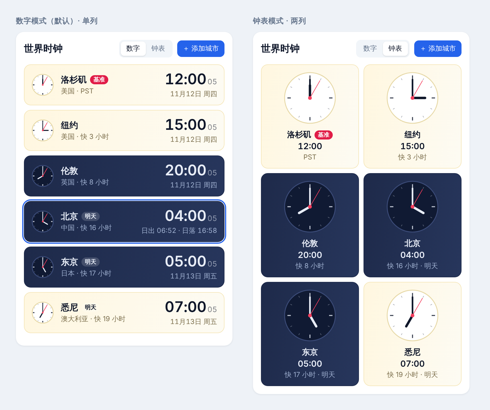

# 功能方案（二）：添加任意城市、可切换基准、城市卡片改版

> 编写日期：2026-11-13。状态：**已完成**，三个待确认项按默认执行（在线搜索、做“跟随设备时区”且默认关闭、默认数字模式）。与方案的出入见文末“执行记录”。

三个目标：

1. 能添加预置 18 个以外的城市。
2. 基准时间可以在界面上切换，出差时不用改代码。
3. 侧栏城市卡片重新设计，支持数字 / 钟表两种样式。

三件事都要动"城市"这份数据，所以先改数据模型，再做界面。

| 阶段 | 内容 | 验收 |
|---|---|---|
| A | 数据模型：自定义城市、基准城市进入状态 | 单元测试；页面行为与现在一致 |
| B | 添加城市：搜索任意城市 | 能搜到并添加预置以外的城市，刷新后还在 |
| C | 基准切换：卡片上"设为基准" + 设置面板 | 切到东京后，顶栏、时差、地图红圈、滑块全部跟着变 |
| D | 城市卡片改版 | 截图比对两种样式、浅色 / 深色 |

---

## 阶段 A：数据模型

现状的两个限制：

- 已选城市只存 id（`selectedCities: string[]`），只能指向 `MAJOR_CITIES` 里的 18 个。
- 基准是编译期常量 `BASE_ZONE`。

改动：

- **自定义城市**：`timeStore` 新增 `customCities: CityData[]`，与 `selectedCities` 一起持久化。`getCitiesByIds` 改为先查预置、再查自定义。自定义城市的 id 用 `custom-<数据源 id>`，避免与预置冲突。
- **`CityData.utcOffset` 改为可选**：它是静态参考值，上一轮已经没有逻辑依赖它，自定义城市不填。
- **基准城市**：`settingsStore` 新增 `baseCityId`（持久化，默认 `los-angeles`）和 `followDeviceZone: boolean`（默认关）。
- **`BASE_ZONE` 常量降级为默认值**：新增 `useBaseZone()` hook 和等价的非 hook 读取函数，返回 `{ timezone, label, cityId }`。`label` 由城市名派生（"东京时间"）。所有读 `BASE_ZONE` 的地方（`timeStore`、`Header`、`TimeSlider`、`WorldClock`、`CityTimeCard`、`WorldMap2D`）改为读它。
- **`timeStore` 响应基准变化**：基准变了以后，`baseTime` 换到新时区、重算城市。时刻本身不变，只是换个时区表示，所以暂停状态和偏移都保留。
- **约束**：基准城市不能从列表里移除（移除按钮隐藏）；持久化数据里的基准城市若已不存在，退回默认。

---

## 阶段 B：添加任意城市

### 数据从哪来

| 方案 | 覆盖 | 中文名 | 离线可用 | 代价 |
|---|---|---|---|---|
| **① 在线搜索（推荐）** | 全世界任意城镇 | 有 | 否 | 搜索词会发给第三方服务 |
| ② 内置更大的列表 | 几百个大城市 | 需要我手工补，可能有错 | 是 | 包体积变大，小城市搜不到 |
| ③ 手动填写 | 任意 | 自己填 | 是 | 要自己查经纬度和时区名，麻烦 |

推荐 ①，用 Open-Meteo 的地理编码接口：免费、不需要 key、支持中文查询和中文结果，一次返回城市名、国家、经纬度、IANA 时区，正好是我们需要的全部字段。预置的 18 个城市保留为离线可用的快捷选项。

需要你知道的两点：搜索时输入的城市名会发送到 `geocoding-api.open-meteo.com`；没有网络时只能加预置城市。添加之后的城市存在浏览器本地，之后显示时间不再联网。

### 界面

现在有两个重复的入口（"添加城市"弹窗、侧栏"添加"标签页），合并成一个：

- 侧栏"添加"标签页作为唯一入口，顶部一个搜索框。
- 没输入时：显示预置城市，按当前 UTC 偏移分组（现有行为）。
- 输入后：300 ms 防抖调用搜索，结果每行显示"城市名 · 省 / 州 · 国家 · 当地现在时间"，点一下添加。重名城市（如多个 Springfield）靠省 / 州和国家区分。
- 加载中、无结果、网络失败三种状态都有明确提示；失败时仍可从预置里选。
- 世界时钟页的"添加城市"按钮改为跳到这个标签页，原弹窗删除。

---

## 阶段 C：切换基准

两个入口，改的是同一个设置：

- **卡片上**：每张卡片悬停时出现"设为基准"按钮（图钉图标）。出差时点一下目的地城市即可，这是最快的路径。
- **设置面板**：现在点齿轮只显示"开发中"。做成真正的面板，本轮只放与这次需求有关的三项：
  - 基准城市（下拉，从已添加的城市里选）
  - 跟随设备时区（开关）
  - 卡片样式（数字 / 钟表，见阶段 D）

**跟随设备时区**：打开后，基准取浏览器报告的时区。笔记本和手机到了外地通常会自动改时区，这样连点都不用点。若列表里有同时区的城市，就把它当基准城市；没有的话，基准显示为时区名（如 "Asia/Tokyo 时间"），地图上不画基准红圈。默认关闭，保持现在"固定洛杉矶"的行为。

切换后会跟着变的地方：顶栏和滑块的"××时间"及时区缩写、每张卡片的"快 / 慢 N 小时"和"明天 / 昨天"、侧栏排序（基准排第一）、地图上的红圈、底部滑块显示的日期时间。

---

## 阶段 D：城市卡片改版

示意图：

### 现在的问题

- 380 px 宽的侧栏里排两列，每张卡片很挤，信息竖着堆了七八行。
- 红色的移除按钮一直显示，最抢眼的反而是最不常用的操作。
- 昼夜同时用左边框颜色、太阳图标、底部 emoji 表达了三遍。

### 新设计

**昼夜用卡片底色表达**：白天是暖白色，夜晚是深蓝色，一眼能看出哪些城市在睡觉，不再需要图标和 emoji。

**数字模式（默认）**：单列，每个城市一行。

- 左：小钟面（40 px）
- 中：城市名 + 徽标（"基准"、"明天 / 昨天"），下面一行"国家 · 快 16 小时"
- 右：大号时间，秒数缩小变淡；下面一行日期和星期

**钟表模式**：两列，每格一个大钟面（约 92 px），下面是城市名、数字时间、时差。

**两种模式共用**：

- 钟面是 SVG，白天白底深色指针，夜晚深底浅色指针，秒针红色。
- 移除、"设为基准"两个按钮只在悬停（或键盘聚焦）时出现。
- 选中的卡片加蓝色描边，并把日期那一行换成"日出 06:52 · 日落 16:58"。日出日落用已安装的 `suncalc` 按城市经纬度计算，极昼极夜时显示"极昼 / 极夜"。
- 头部的"网格 / 列表"切换换成"数字 / 钟表"切换，选择保存到本地。头部按钮现在会折行，一并修掉。

深色主题下白天卡片改用低饱和的暖灰，避免在深色界面里太刺眼；具体颜色实现时对着截图调。

---

## 不在本轮范围

- 设置面板里的其他项（12 小时制、语言、秒显示开关）。面板做出来后，这些以后加起来很快。
- 日期选择（看别的季节）、3D 视图、触摸手势。

---

## 执行记录

与方案不一致的地方：

- **基准设置放在 `timeStore` 而不是 `settingsStore`**：`baseTime` 的时区直接取决于它，放在同一个 store 里不需要跨 store 调用，持久化也一起做了。`BASE_ZONE` 常量改为 `DEFAULT_BASE_CITY_ID`。
- **设置面板多了“主题”一项**（浅色 / 深色 / 跟随系统），原来只能在顶栏两态切换。
- **手机上的卡片按钮**：触屏没有悬停，改为先点一下选中卡片，按钮才出现，避免每张卡片都常驻按钮。
- **时区缩写**：东京这类没有通用缩写的时区，Intl 只给出 `GMT+9`，统一改为 `UTC+09:00`。
- **Tailwind `primary` 色阶**原来只定义了 50/500/600/700/900，项目里用到的 100–400 一直不生效（深色下侧栏标签看不清就是这个原因），已补齐。
- **在线搜索的页面验证**：开发容器的网络代理拦截了 Open-Meteo，页面测试用模拟响应完成；单元测试覆盖了请求参数、结果转换和错误处理。真实接口在浏览器里直接访问，不受影响。

## 需要你确认的三点

不回复就按默认执行。

1. **城市数据来源**：默认用在线搜索（方案 ①）。如果你不希望页面访问第三方接口，改用方案 ②，我内置大约 200 个大城市。
2. **跟随设备时区**：默认做这个开关，且默认关闭。不需要的话可以不做，只保留手动切换。
3. **卡片默认样式**：默认数字模式。想一打开就是钟表模式的话告诉我。
